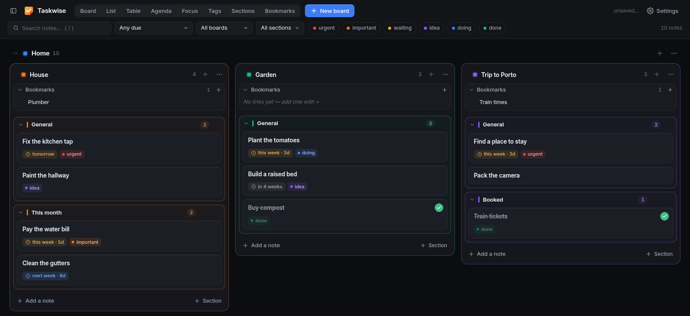

# taskwise

Project boards in your browser. taskwise keeps notes in boards and groups, with
links, tags and due dates you type in plain words ("next week", "before the
15th"). The same notes can be seen as a table, an agenda, a focus list and other
views.



Everything is saved to one file, `board.json`, in a folder you choose. Put it in
a synced folder to use the same boards on several machines.

## Install

Requires Arch Linux, or another system with Python 3.11+ (the installer uses
pacman for system packages).

```bash
git clone https://github.com/davidnsousa/taskwise
cd taskwise
./install.sh
```

The script installs taskwise to /opt/taskwise with its own Python environment
(it uses sudo), adds an app-menu entry and sets up start on demand.

## Use

Open http://127.0.0.1:8243 or use the app-menu entry. On first start taskwise
asks for a data folder (default ~/taskwise).

You do not have to start taskwise yourself. systemd listens on that address from
login on, which costs no memory, and starts taskwise on the first visit. It stops
about 10 seconds after you close the last tab. Without systemd, start it from
the app menu or with the commands below.

| Command | What it does |
|---|---|
| `taskwise --open` | open it in your browser, starting it first if needed |
| `taskwise --port N` | run in this terminal on another port (Ctrl-C to stop) |
| `taskwise --start` | start in the background without opening a browser |
| `taskwise --uninstall`, `-R` | remove taskwise; your board is not touched |

## Update

taskwise tells you when there is a newer version on GitHub, checking at most once
an hour. To update, run `git pull` and then `./install.sh` again.

## Features

**Boards**
- Groups, boards and sections, with drag and drop
- Collapse, hide or hibernate groups and boards

**Notes**
- Add from the + under Links, picking the section; quick add takes `#tags` and a due date after `!`
- Due dates in plain words, shown relative to today
- Filters by search, due date, board, section and tag
- Notes can depend on other notes; the Graph view draws who waits on whom
- Each board has a folded Archive: done notes go there, and any note can be archived

**Views**
- Board, List, Table, Agenda, Focus, Tags, Sections, Links and Graph

**Links**
- Web links and local files on each board, in nested folders
- Drag a link onto a note on any board to attach it

## Network use

taskwise runs locally. It contacts the sites in your Links to get their icons, and
GitHub for the update check.

## Where data lives

- `<your folder>/board.json`: everything on your boards; `board.json.bak` is the
  previous save
- `~/.config/taskwise/config.json`: which folder you chose
- `~/.config/taskwise/settings.json`: theme, text size, last view and filters
- `~/.cache/taskwise/favicons/`: link icons
- `~/.local/state/taskwise/`: update check state, and the server log when
  started without systemd
- `journalctl --user -u taskwise`: the server log when systemd started it
- `/usr/local/lib/systemd/user/taskwise.socket` and `taskwise.service`: the start
  on demand. `systemctl --user disable --now taskwise.socket` turns it off for
  your user.

## Credits and license

taskwise uses [FastAPI](https://github.com/fastapi/fastapi) (MIT) and
[uvicorn](https://github.com/encode/uvicorn) (BSD-3-Clause). The interface font
is [Inter](https://github.com/rsms/inter), under the SIL Open Font License
([static/fonts/Inter-LICENSE.txt](static/fonts/Inter-LICENSE.txt)). Written with
AI assistance (Claude).

Copyright (C) 2026 David Sousa. taskwise is licensed under the MIT License
([LICENSE](LICENSE)).
